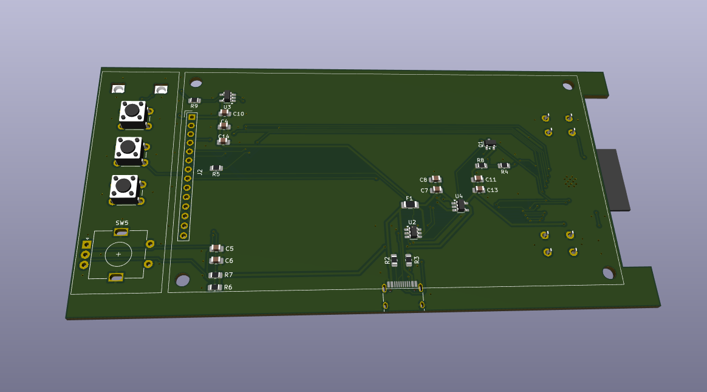
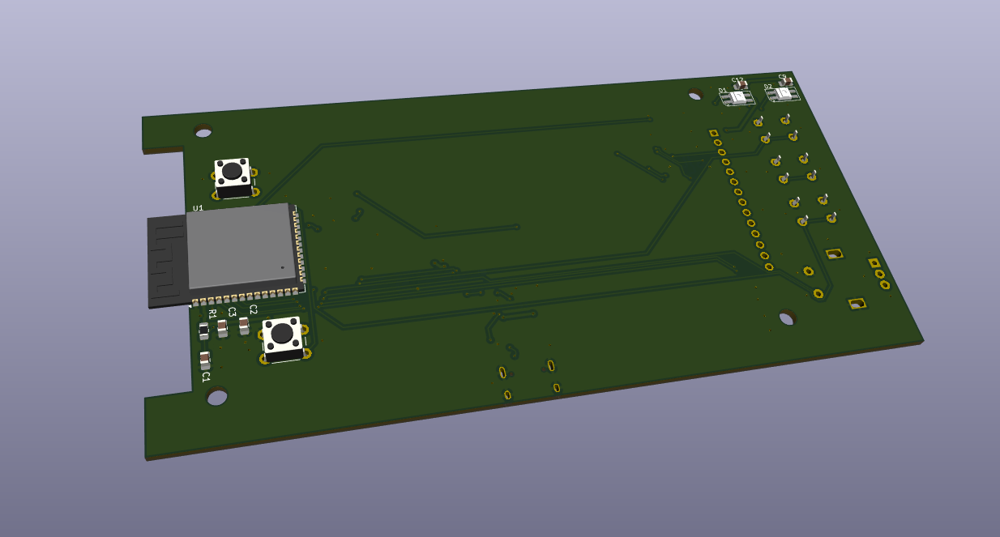
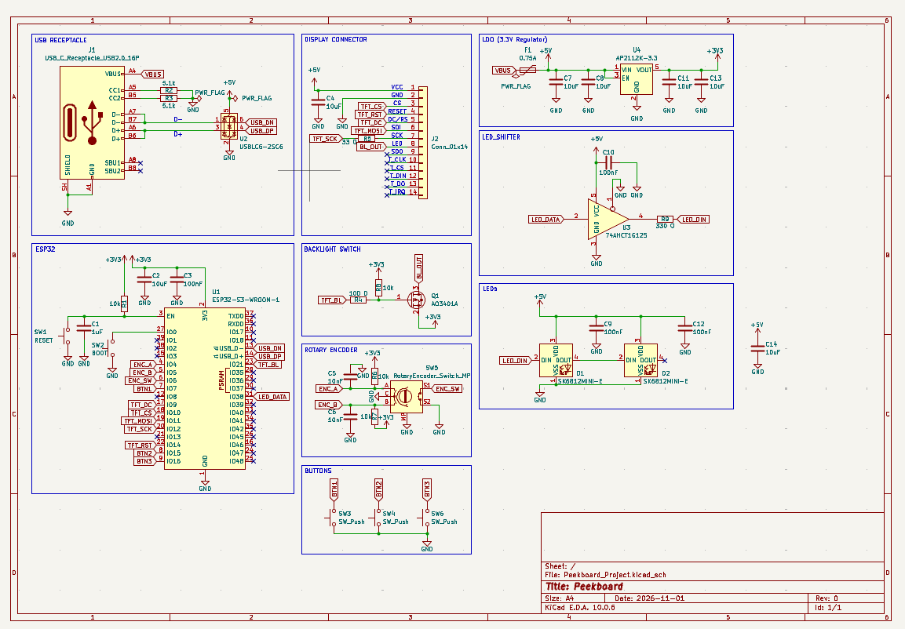
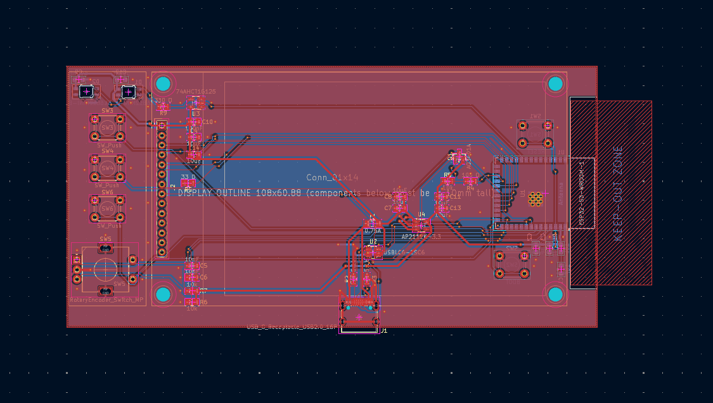
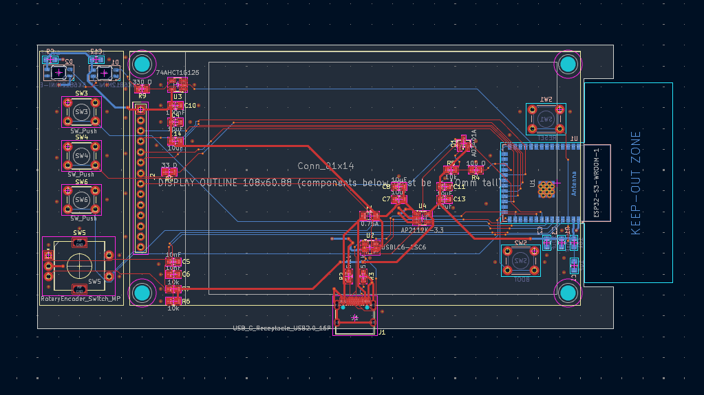

Repo for peekboard a small desk display, showing some infos about this and that 

# peekboard

This is a practical and useful table display. Its meant to create a info dashboard to display all sorts of stuff. It could show your notifications and files or simply the time and date. 
This project is WOP so expect changes and updates in future!

# What is this

Peekboard is another project, made for the [Half life](https://halflife.hackclub.com) by Hackclub YSWS program. The motivation for this project was to build a display. Since bigger displays cost more money, this 4" TFT screen was everything that fit into the tight budget. Even though the limitations, I think it worked out quite nicely and im really excited to test it out myself.

The Board features as probably suspected a Microcontroller, display, some buttons and rotary encoders and a USB-C receptacle. The whole board fits into one hand!

# Project status

The project is as already said a WOP and there will come more polished versions of the project. Also in work is an enclosure for the display, that can be 3D printed.  

# Detailed description

More detailed description coming soon. For now refer to the images and the #What is this chapter.
-features
-controls
-menus
-settings

# Motivation

There was no deeper motivation than to differentiate my skills more and test some new components. Half life gave the display topic and I went with it happily.

# Project journaling

Via the [Half life](https://halflife.hackclub.com) by Hackclub programm, several Journal entries have been made either in timelaps form or as written entry to track the project, that describe the project further. Right now they arent public, but either they will, or some screenshots will be added to the repo

# Assembly

The assembly should be quite beginnerfriendly. All components can be handsoldered onto a PCB that can be ordered by a manufacturer like [JLPCB](https://jlcpcb.com/). Maybe a video tutorial will be added later (if the repo is seen, but prob. not). 

# Schematic and components

The board is powered by the ESP32-S3-WROOM-1-N16R8. It provides some power and data for flashing and firmware. The board also features another USB-C receptacle for main power of the TFT screen. This display is a 4" st7796 SPI TFT 480x320 screen, that is fairly big for its price. For navigation, setup and use, there are several buttons and rotary encoders.
If you want to see the schematic in more detail, have a look into the images folder!

# PCB

The PCB is a simple 2 layer PCB with another silkscreen layer for cosmetic and organisational purposes. The board also has a standart GND pour and features routing on the front and backside.

closeup

# Firmware

There is no official firmware yet but there is some test software inside the repo and the basic firmware for the screen. More will follow soon.
!Short disclaimer for half life!
There is no finished .ino or .py file in the repo but there are some test script in other formats for the screen. The actual finished firmware will be created in the build week.

# BOM
There are two BOM files inside the repo. One is the entire parts list with all passives and main components. Its stored in BOM2. The other is the list below or saved in [BOM.csv](BOM.csv). THis is the funded parts list for the YSWS program by hackclub. If you build the project, you will need BOM2. 

embedded (HL): 
PEEKBOARD – bill of materials
!! The PCB manufacturing was excluded from the list unfortunately because of over budgeting :(
				
| Part | Qty | Unit-Price | total | Shop | Link |
| --- | --- | --- | --- | --- | --- |
| 4" st7796 SPI TFT 480x320 | 1 | $20.93 | $20.93 | AliExpress | [Link](https://de.aliexpress.com/item/1005007609041421.html?spm=a2g0o.cart.0.0.502038dawLfZEM&mp=1&gatewayAdapt=glo2deu) |
| USBLC6-2SC6 | 1 | $1.72 | $1.72 | AliExpress | [Link](https://de.aliexpress.com/item/1005007348100430.html?spm=a2g0o.cart.0.0.502038dawLfZEM&mp=1&gatewayAdapt=glo2deu) |
| AP1221K-3.3 TRG1 | 1 | $2.36 | $2.36 | AliExpress | [Link](https://de.aliexpress.com/item/1005005807114594.html?spm=a2g0o.cart.0.0.502038daN9aA73&mp=1&gatewayAdapt=glo2deu) |
| AO3401A | 1 | $2.09 | $2.09 | AliExpress | [Link](https://www.aliexpress.com/item/1005006220143887.html?spm=a2g0o.cart.0.0.44c538daCDAQGZ&mp=1) |
| Alps EC11E155244G1 | 1 | $1.27 | $1.27 | AliExpress | [Link](https://de.aliexpress.com/item/1005007644083514.html?spm=a2g0o.cart.0.0.502038daN9aA73&mp=1&gatewayAdapt=glo2deu) |
| 1206 PTC self recovery fuse 0.75A | 1 | $1.93 | $1.93 | AliExpress | [Link](https://de.aliexpress.com/item/1005005750933997.html?spm=a2g0o.cart.0.0.44c538daCDAQGZ&mp=1&gatewayAdapt=glo2deu) |
| (PCB manufacturing) | 5 | $8.6 | $8.6 | JLPCB | [Link](https://cart.jlcpcb.com/de/quote?stencilLayer=2&stencilWidth=100&stencilLength=100&stencilCounts=5&plateType=1&spm=Jlcpcb.Homepage.1010) |
| **Total** | **$28.93** | | Shipping: free | (Shipping for PCB: $8.99) | |

